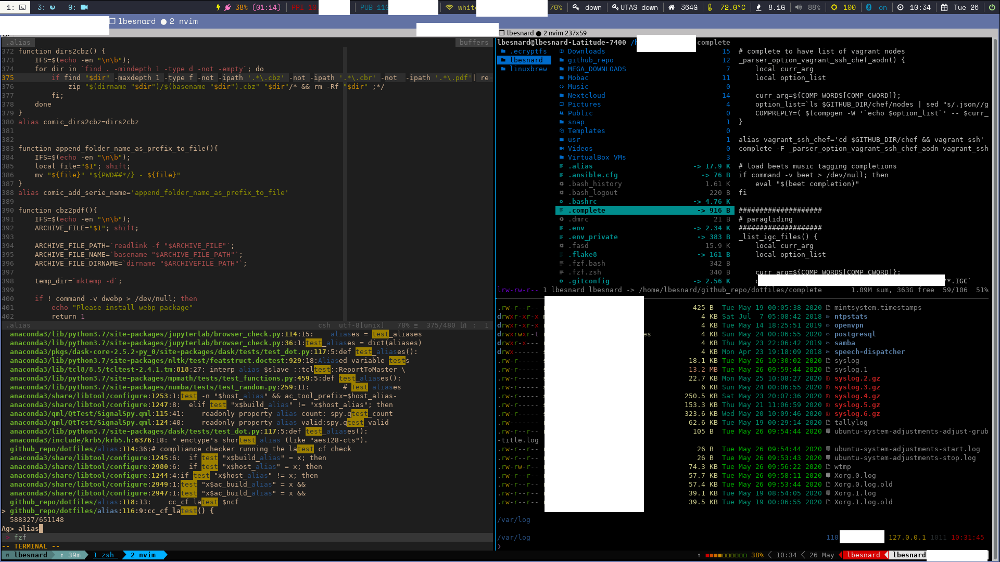

# dotfiles

Configuration for the machines I use: laptop (i3), remote servers, a home server and
a phone (Termux). One repo, linked into `$HOME` with [dotbot](https://github.com/anishathalye/dotbot).



## What's in it

* **Shell**: [zsh](https://www.zsh.org/) with [zinit](https://github.com/zdharma-continuum/zinit) turbo mode
  (plugins load *after* the first prompt, so startup is ~50 ms),
  [starship](https://starship.rs) prompt, [zoxide](https://github.com/ajeetdsouza/zoxide) (`j`),
  [fzf](https://github.com/junegunn/fzf) + [fzf-tab](https://github.com/Aloxaf/fzf-tab)
* **Terminal**: [tmux](https://github.com/tmux/tmux) (plugins via [tpm](https://github.com/tmux-plugins/tpm)),
  [ghostty](https://ghostty.org) / alacritty
* **Editor**: [neovim](https://neovim.io) with [LazyVim](https://www.lazyvim.org)
* **Files / search**: [yazi](https://yazi-rs.github.io), ranger, `fd`, `ripgrep`, `bat`, `eza`
* **Git**: [forgit](https://github.com/wfxr/forgit), [tig](https://github.com/jonas/tig),
  [gh](https://cli.github.com) with custom aliases (`bin/git-alias`, `bin/gh-aliases`)
* **Desktop**: i3, i3blocks, rofi
* **Misc**: [cheat](https://github.com/cheat/cheat), [lnav](https://lnav.org), taskwarrior, beets, cmus
* **Packages**: [zerobrew](https://zerobrew.rs) (fast, sudo-free Homebrew-compatible client), listed in [`Brewfile`](Brewfile)

## Install

Needs git and curl. If a private repo or submodule is involved, set up your SSH key first:

```bash
eval "$(ssh-agent -s)" && ssh-add     # ~/.ssh/id_rsa
```

### Any Linux/macOS machine, no sudo

```bash
curl -fsSL https://raw.githubusercontent.com/lbesnard/dotfiles/main/initsys.sh | bash
```

This installs zerobrew, makes a **shallow** clone of this repo into `~/github_repo/dotfiles`,
installs the `Brewfile` packages and links everything into `$HOME`. It is safe to re-run (it
updates instead of cloning again).

Add `-s -- --ansible` to also run the user-level roles of
[Fleet-Control](https://github.com/lbesnard/Fleet-Control/tree/master/ansible)
(miniforge, neovim, cheat):

```bash
curl -fsSL https://raw.githubusercontent.com/lbesnard/dotfiles/main/initsys.sh | bash -s -- --ansible
```

### Laptop (full system, sudo)

System packages, i3, fonts etc. are provisioned by Fleet-Control, which also installs these dotfiles:

```bash
ansible-pull -U https://github.com/lbesnard/Fleet-Control.git \
             -d ~/ansible_pull_tmp -i ansible/hosts ansible/local.yml -K
```

### Manual

```bash
git clone --depth 1 https://github.com/lbesnard/dotfiles.git ~/github_repo/dotfiles
cd ~/github_repo/dotfiles
./install          # fetches submodules (shallow) and links the files listed in install.conf.yaml
```

Re-run `./install` after adding a link to `install.conf.yaml`.

### Termux (Android)

First sync the Termux packages (a partial upgrade leaves `curl`/`git` broken with `cannot locate symbol "SSL_set_quic_tls_early_data_enabled"`):

```bash
pkg update -y && pkg upgrade -y
```

Then:

```bash
curl -fsSL https://raw.githubusercontent.com/lbesnard/dotfiles/main/termux-install.sh | sh
```

[`termux-install.sh`](termux-install.sh) runs `pkg upgrade`, installs the core tools (zsh, tmux, perl, starship, zoxide, fzf, openssh, neovim)
plus Termux equivalents of the packages in Fleet-Control's `homebrew_packages.yml` (bat, eza, fd, ripgrep, yazi,
lazygit, gh, ...) with `pkg`; packages missing from the Termux repo are skipped and listed. It then shallow-clones this repo into `~/dotfiles`, runs `./install` (dotbot, like every other machine) and sets zsh as login shell. Re-running updates.

* It uses `pkg` rather than zerobrew: zerobrew's binaries are built for glibc, Termux uses bionic.
* **`cannot locate symbol "SSL_set_quic_tls_early_data_enabled"` from `git`/`curl`**: your Termux packages
  are partially upgraded (new libcurl, old openssl). Run `pkg update -y && pkg upgrade -y` (try
  `termux-change-repo` if a mirror is stale), then re-run the installer. The script does this upgrade itself.
* `zsh/zshrc.termux` is a self-contained, minimal zsh config. tmux autostarts in interactive shells
  (attaches to session `main`); set `export TERMUX_NO_TMUX=1` in `~/.zshenv` to disable.
* tmux uses the same [Oh my tmux!](https://github.com/gpakosz/.tmux) `tmux.conf` as the other machines, with
  [`tmux/tmux.conf.termux`](tmux/tmux.conf.termux) as its `~/.tmux.conf.local`. That file sources
  `tmux.conf.ssh` (the server look, prefix `C-b`) and adds phone tweaks (no pane-border row, no plugin cloning,
  Android clipboard). Oh my tmux needs `perl`, which the installer adds.
* Optional: `pkg i termux-api` (+ the Termux:API app) so copy-mode `y` reaches the Android clipboard;
  `pkg i termux-services` then `sv-enable ssh-agent` / `sv-enable sshd` to run them as services.

## Secrets

This repo is public, but credentials live in it **encrypted** with [age](https://age-encryption.org).
Everything listed in [`manifest.list`](manifest.list) (aws, ssh config, tokens, taskrc, ...) exists as:

* a plaintext file in the usual place: **gitignored**, so `git status` never shows it;
* a `<file>.age` next to it: encrypted to the public key in [`recipients.txt`](recipients.txt), **committed**.

The private key is `~/.config/age/key.txt`. It is not in the repo; keep a copy in KeePass.
Without it you get the public dotfiles only and everything else still works.

### New machine

`./install` does it all: it offers to install zerobrew + `age` (and `pre-commit` via pip),
asks you to paste the key (hidden; the `AGE-SECRET-KEY-1...` line is enough, it is checked against
`recipients.txt`), decrypts, installs the git hooks and links the secret files
(`bin/link-manifest`, from [`manifest.list`](manifest.list)). Press Enter at the key prompt to skip.

### Changing a secret

`git status` will **not** show an edited secret (it is gitignored). Check with:

```bash
cd ~/github_repo/dotfiles
./secrets status                      # "plaintext differs from .age" = you have an unencrypted change
./secrets encrypt                     # writes the .age files
git add -A && git commit -m "..." && git push
```

Run `./secrets encrypt` yourself when the secret is the only thing you changed: the commit hook only
runs once git sees something to commit, so a secret-only change would otherwise say "nothing to commit".
When you commit other files too, the hook re-encrypts for you (with the pre-commit framework the first
attempt stops once after staging the `.age` files; commit again). It also refuses to commit a plaintext
secret or an `*.age` file that is not really age.

### Pulling a change

A `post-merge` / `post-rewrite` hook runs `./secrets decrypt` after `git pull`, so the plaintext follows.
It never overwrites a local edit that was not encrypted yet: you get a `CONFLICT` line and your file is kept
(`./secrets decrypt --force` to take the repo's version). It says what it did (`secrets: refreshing decrypted secrets after pull...`, then `decrypt: N updated, M unchanged`); without a key it prints a one-line note, without `age` it warns.
`git pull` itself never fails because of it.

### Adding a secret

1. Add one row to `manifest.list`: path, link target (or `-`), `secret`. `encrypt` adds the `.gitignore` pattern itself, `link-manifest` makes the symlink.
2. `./secrets encrypt`, then commit the new `.age` file.

A secret is listed only in `manifest.list`. Whole-folder links like `~/.aws` stay in `install.conf.yaml` (they don't need the key).

### Commands

`secrets` is also on your `PATH` (`bin/secrets`), so these work from any directory, with zsh tab completion.

| Command | |
| --- | --- |
| `./secrets status` | key, hook, and the state of every secret |
| `./secrets encrypt [--stage\|--add]` | re-encrypt changed plaintext (only if it really changed; age output is random) |
| `./secrets decrypt [--force] [--quiet\|--hook]` | write plaintext from the `.age` files |
| `./secrets install-hook` | git hooks: pre-commit framework if it runs, else plain git hooks |
| `./secrets install-completion` | link the zsh completion (`zsh/completions/_secrets`) into your `$fpath`; `./install` does it too |
| `./secrets bootstrap` | the interactive install/paste-the-key step of `./install` |

### Machine-specific configs (apps that rewrite their own files)

Some apps (Nextcloud, Joplin, Digikam, Darktable) silently update their own config
on each machine, causing `CONFLICT` warnings after every pull.
They are stored as `config/APP/name.<hostname>.ext` and symlinked at install time by
[`bin/link-manifest`](bin/link-manifest).

**Adding a new machine** (run on the new machine after cloning):

```bash
cp ~/.config/Nextcloud/nextcloud.cfg \
   ~/.dotfiles/config/Nextcloud/nextcloud.$(hostname -s | tr A-Z a-z).cfg

cp ~/.config/joplin-desktop/settings.json \
   ~/.dotfiles/config/joplin-desktop/settings.$(hostname -s | tr A-Z a-z).json

cp ~/.config/digikamrc \
   ~/.dotfiles/config/digikamrc.$(hostname -s | tr A-Z a-z)

cp ~/.config/darktable/darktablerc \
   ~/.dotfiles/config/darktable/darktablerc.$(hostname -s | tr A-Z a-z)

cd ~/.dotfiles
./secrets encrypt   # for Nextcloud and Joplin (they are flagged secret in manifest.list)
git add -A && git commit -m "hostname configs: $(hostname -s | tr A-Z a-z)" && git push
./install
```

`bin/link-manifest` prints `MISSING: …` with the exact copy command for any
file not yet present, so you know exactly what to do on a fresh machine.

The hostname is always lowercased (`hostname -s | tr A-Z a-z`), so `Latitude-7450` becomes `latitude-7450`.

**Adding a new app** to this mechanism: add one line to [`manifest.list`](manifest.list), nothing else:

```
config/APP/name.{hostname}.ext   ~/.config/APP/name.ext   secret
```

`{hostname}` is the lowercased `hostname -s` and each machine only uses its own file. Add `secret` if
the file has credentials: `./secrets` then encrypts it and adds the gitignore pattern itself.
`bin/link-manifest` does the linking. It replaces existing symlinks but never a real file or directory: it reports
`EXISTS:` and exits 1 (`./install` prints a reminder); after checking, `bin/link-manifest --force` moves it to
`<target>.bak.<timestamp>` and links.
To encrypt just one file: `./secrets encrypt config/APP/name.<host>.ext`.

### funk sync tasks (`funk/*.json`)

The `funk_rsync_config` / `funk_rclone_config` / `funk_rsync_cron` tasks live in one encrypted file **per machine that
runs them**, named after its lowercase `hostname -s` (`funk/beefunk.json`, `funk/lbesnard-latitude-7450.json`, ...),
each `{"tasks": [...]}`. `./install` links the files into `~/.funk_rsync.d`; `alias_sync` loads only this machine's
file plus any `_*.json` (loaded everywhere, e.g. `_unassigned.json` for tasks whose destination is
`TO_BE_FILLED_MANUALLY`). Inside, destinations that are mount points are still filtered by what is mounted.
New machine: create `funk/<hostname>.json`, `./secrets encrypt`, commit.

### Keep in mind

* The ciphertext is public and permanent. If the key leaks, anything ever pushed can be read, and changing
  `recipients.txt` does not help for old commits: **rotate the secrets themselves** (new tokens, keys, passwords).
* Never commit a secret in plaintext by accident: if you did, rewriting history is not enough on its own,
  see how [fleet-compose rotates TLS/ACME keys](https://github.com/lbesnard/fleet-compose/blob/master/docs/rotate-tls-and-acme.md).
* The key is a random file, not a passphrase, so brute-forcing the public ciphertext is not realistic.
* When the secrets hook says `CONFLICT … has local edits not yet encrypted; kept it`: your local
  file is safe. Run `./secrets encrypt && git add -A && git commit` to push your version, or
  `./secrets decrypt --force` to overwrite with the repo's version.

## How the zsh config is organised

| File | Role |
| --- | --- |
| `zsh/zshrc` | Detects the machine profile once (`termux`, `server`, `homeserver`, `laptop`; override with `ZSH_PROFILE_NAME`) and sources the right files |
| `zsh/zshrc.common` | Shared config: tmux autostart (first, so the outer shell does no wasted work), zerobrew PATH, prompt, turbo-loaded plugins, fzf, completion styling |
| `zsh/zshrc.laptop`, `.server`, `.homeserver` | Per-machine additions |
| `zsh/zshrc.termux` | Standalone Termux config |
| `zsh/functions/`, `zsh/completions/` | Autoloaded functions and completions |
| `alias` | Core aliases and helpers (loaded last so they override plugin aliases); sources the domain files below |
| `alias_forgit` | [forgit](https://github.com/wfxr/forgit) aliases, kept separate to avoid conflicts with `grc` |
| `alias_sync` | Server sync: `funk_rsync` / `funk_rclone`, NFS mounts, SSH tunnels, crowdsec |
| `alias_taskwarrior` | All taskwarrior interactive functions (`td`, `ttl`, `tlog`, `tpurge`, …) |
| `alias_gaming` | Emulation helpers: vita, `v64toz64`, `zip2chd` |
| `alias_netcdf` | NetCDF / compliance checker helpers (`ncbrowse`, `ncdumph`, `cc_cf`, …) |
| `config/starship.toml` | Prompt config |

Profile startup with `ZSH_PROFILE=1 zsh -i -c exit` (prints a zprof report), or
`for i in {1..5}; do time zsh -i -c exit; done`.

## Adding a package

```bash
zb install <formula>
zb bundle dump -f Brewfile --force     # keep Brewfile in sync
```

## Layout

```
install, install.conf.yaml      dotbot entrypoint and link map
initsys.sh, Brewfile            bootstrap for fresh machines
termux-install.sh               bootstrap for Termux (Android)
zsh/ tmux/ nvim/ config/        tool configs (config/* is linked into ~/.config)
bin/                            scripts, put on $PATH as ~/bin
  link-manifest                 symlinks the manifest.list rows that have a target (secrets, per-machine configs)
alias, alias_*                  shell aliases split by domain (sync, taskwarrior, gaming, netcdf)
secrets, manifest.list           age-encrypted secrets: tool, manifest of files (+ *.age, recipients.txt)
```
